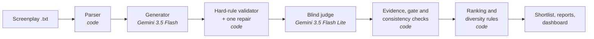

# PromoPilot

**An AI-powered tool that reads microdrama screenplays, finds high-potential promo moments, and ranks them using
structured quality checks, while showing exactly where it gets things wrong.**

Kuku AI Generalist assignment · Problem 1: *Find the Promos*

| | |
|---|---|
| **Live app** | _add the Streamlit link here_ |
| **Solution document** | _add the link to the 2-page PDF here_ |
| **Raw outputs** | [`published/fullpack/runs/fullpack-v1-20261106/`](published/fullpack/runs/fullpack-v1-20261106/) (unedited output of the full 50-episode run) |
| **Walkthrough video** | _add the link here_ |
| **Full command reference** | [docs/REFERENCE.md](docs/REFERENCE.md) |

---

## At a glance

- **What it does:** reads 50 timestamped screenplays and returns a ranked list of 20–60 second promo clips. Each
  clip has the episode, start and end timestamps, the hook line, the cliffhanger line, why it works and why it
  holds its rank.
- **Key idea:** the AI makes the judgement calls, and code checks everything that can be checked. The model only
  points at screenplay lines and never writes a timestamp, so it cannot invent a moment.
- **Result:** 147 candidate clips were proposed. 37 were rejected by the checks, with reasons, 110 passed every
  check, and the best 25 make up the shortlist.
- **Honest about quality:** every rejection is explained, and the app's front page shows where the tool picks
  badly. Scores are one AI model's assessment, not audience data.
- **Runs on new input:** upload your own screenplay files (or a `.zip`) in the app, and the same pipeline runs
  live.

## The problem

Today an editor watches every episode and picks promo moments by hand, one show at a time, while new shows are
released every week. A promo is a 20 to 60-second clip from the show, posted on Instagram, TikTok or YouTube to
pull in new viewers. A good one:

- **opens on a hook**: something in the first 3 seconds that stops a scrolling viewer, like a slap, a reveal or a
  shocking line;
- **ends on a cliffhanger**: it cuts at an unresolved moment, so the viewer needs to know what happens next;
- **makes sense on its own** to someone who has never seen the show.

PromoPilot only finds promos: the right moments and the right start and end points. It does no video editing,
music, captions or text overlays.

## What you get for each promo

| Field | Example: promo #1 |
|---|---|
| Episode | Episode 1 (`EP001_C03`) |
| Segment | 00:39.00 → 01:18.50 (39.5 s) |
| Hook | 00:39.10 · LADY IN GOLD GOWN: "Because he is marrying me." |
| Cliffhanger | 01:15.00 · LADY IN GOLD GOWN: "Long enough to know he was never going to marry you." |
| Why it works | Witness the ultimate betrayal when a sister steals the bride's groom at the altar. |
| Why this rank | Weighted score 5.00 of 5, ahead of #2 (4.60). |

Hook and cliffhanger lines are quoted verbatim from the screenplay, and every timestamp comes from the screenplay
itself.

## Results on the 50-episode input pack

| Measure | Value |
|---|---|
| Episodes processed | 50 (all complete) |
| Candidate clips evaluated | 147 (141 proposed by the generator, 6 repaired versions) |
| Broke a hard rule (bad boundaries) | 9 |
| Failed a quality gate (too weak to post) | 28 |
| Eligible clips (complete catalogue) | 110 |
| **Shortlisted promos** | **25**, from 20.7 to 57.5 seconds long |
| Episodes with at least one eligible promo | 48 of 50 (EP006 and EP038 have none) |
| Clips flagged for human review | 3 (EP004_C02, EP022_C03, EP039_C01), none of them shortlisted |

**Top five:** EP001_C03 (5.00), EP011_C01 (4.60), EP028_C02 (4.55), EP031_C02 (4.55), EP002_C02 (4.45).

The shortlist is ordered by weighted score, then diversified: at most one promo per episode, at most three per
story archetype, and near-duplicates (more than 50% overlap) removed. The full catalogue of 110 eligible clips is
kept as well.

**Robustness check:** re-ranking with equal weights keeps 24 of the 25 shortlisted promos (one swap), with a rank
correlation of 0.97 across all eligible clips. The ranking does not hinge on the exact weights chosen.

## How it works



1. **Parse** (code). Each episode becomes scenes and timed blocks (dialogue, action, camera, sound), each with a
   stable ID such as `EP001_B027`. Format problems in the source are recorded, never silently fixed.
2. **Generate** (AI). Gemini 3.5 Flash proposes up to five candidate clips per episode, but it can only point at
   block IDs. It never writes a timestamp, so it cannot invent a moment that is not in the script.
3. **Validate** (code). Python enforces the objective rules:
   - 20 to 60 seconds long;
   - hook within the first 3 seconds;
   - no line of dialogue cut mid-sentence;
   - no ending on a bare transition;
   - the clip ends within 2 seconds of its suspense beat.

   A failing clip gets one deterministic repair attempt (for example, trimming to the beat), and the repaired clip
   is checked again from scratch.
4. **Judge** (AI). Gemini 3.5 Flash Lite scores each clip from 1 to 5 on six dimensions: hook, narrative tension,
   cliffhanger, context independence, curiosity gap and emotional impact. Every score must cite the screenplay
   lines it is based on. The judge is **blind**: it sees only the clip's own lines, under neutral IDs, and never
   the generator's reasoning or the rest of the episode. That is also how it tests whether the clip makes sense
   to a new viewer.
5. **Check the judge** (code).
   - Python verifies every citation.
   - It re-runs every hard rule using the judge's own choice of hook and suspense beat. A hard-rule failure is
     final, and the judge cannot override it.
   - Gates require hook, cliffhanger and context scores of at least 3 and an unresolved ending.
   - When a score contradicts the judge's own explanation, the clip gets one targeted reassessment. If the
     contradiction persists, the original is kept and the clip is flagged for a human.
6. **Rank** (code). Weighted score: hook 30%, context independence 30%, cliffhanger 25%, emotional impact 15%. Ties
   are broken by cliffhanger, then hook, then context score. Then the diversity rules are applied.

### Who does what

| AI (Gemini) | Code (Python) | Human |
|---|---|---|
| Proposes candidate clips, as block IDs | Parses screenplays and owns every timestamp | Reviews the shortlist before posting |
| Scores each clip blind, citing evidence | Enforces hard rules; the judge cannot override them | Resolves clips flagged for review |
| Writes the one-line "why it works" | Verifies citations, applies gates, ranks, deduplicates | Sets the weights and gates |

### Why it is built this way

- **Models point, code measures.** Language models are good at judging drama and bad at arithmetic on
  timestamps. Keeping every number in code makes the output checkable and stops invented moments.
- **A blind judge.** If the judge saw the generator's reasoning, it would tend to agree with it. Hiding the
  episode also makes the judge a stand-in for a viewer who has never seen the show.
- **Hard rules in code, not in the prompt.** A prompt can ask for a 3-second hook; only code can guarantee one.
- **No agent framework.** The workflow is a fixed sequence where code makes every decision, so LangChain or
  LangGraph would add a dependency without adding capability. One OpenAI-compatible client keeps the model easy
  to swap: changing it is a setting, not a rewrite.
- **Reproducible.** Every model reply is cached, runs resume where they stopped, and each run records the exact
  dataset, models and prompt versions it used.

## How we know it's good

- **Hard rules are facts, not opinions.** They are enforced in code on the final boundaries. Of the 9 clips that
  broke one, 4 cut a line of dialogue and 5 ended too long after their suspense beat.
- **Every rejection carries the judge's own reasons.** Of the 28 clips that failed a quality gate, 19 had a weak
  cliffhanger score, 13 depended too much on context, 8 ended on a resolved moment, and 1 had a weak hook (a clip
  can fail more than one gate).
- **The judge is checked for contradictions.** 33 reassessments were requested. Where the judge's revision did
  not resolve the contradiction, Python kept the original judgement and flagged the clip (3 clips).
- **The ranking is stable.** Equal weights change one shortlist entry out of 25.
- **413 automated tests** cover the parser, validator, repairs, judge checks, ranking and every page of the app.

## Where it fails

- **One AI judge, not viewers.** Scores are a model's opinion, and the judge comes from the same model family as
  the generator. Scores cluster at 3–4, so differences under about 0.5 are noise. There is no human-labelled set,
  so no accuracy figure is claimed. Every pick needs editorial review before posting.
- **No baseline comparison yet.** The pipeline can score a naive "last 30 seconds of each episode" baseline with
  the same judge, but that comparison has not been run on the full pack.
- **Single continuous clips only.** The brief allows promos stitched from several moments or episodes;
  PromoPilot only finds one continuous stretch of one episode.
- **Known weak picks:**
  - a suspense beat can be a camera shot that the clip ends before it finishes (EP003_C02);
  - clips that start at 00:00 may open on a recap of the previous episode;
  - EP001 dominates the top of the full catalogue;
  - the one-line explanations are model-written, read like ad copy, and have not been reviewed by a person.
- **Screenplay, not video.** It judges what the script says will happen on screen, not the footage, performance
  or music.

## One place an AI model was wrong, and how the system handled it

For **EP036_C03**, the generator named a hook line that starts 3.9 seconds into its own clip, breaking the
3-second rule in its instructions. Because models only cite block IDs and Python computes every offset, the
validator caught this at once and marked the clip as failing.

The clip became eligible only after two things happened:
1. The blind judge, which never saw the generator's choice, independently picked a hook line 1.1 seconds into
   the same, unchanged clip.
2. Python re-checked the 3-second rule on that line, and it passed.

EP041_C02 followed the same path (3.6 s from the generator, 0.0 s from the judge). Both clips' `validation/` files
still show the provisional failure, and their `decisions/` files show the final result.

The judge was also wrong in three reassessments: it raised a contested score instead of fixing the
contradiction. Python rejected those revisions, kept the original judgements and flagged the clips for a human.

## The app

**Top promos** (the default page) shows the ranked promos and a short "where the tool picks badly" summary with
real examples. Everything else is in the sidebar:

- **Full candidate analysis**: every clip with its scores, the judge's reasoning, cited evidence highlighted in the
  screenplay, every hard-rule check, repairs and provenance.
- **Where it picks badly**: every rejected or flagged clip, grouped by what went wrong.
- **Scores and ranking rules**: all scores, eligible clips left out by the diversity rules, and the weights, gates
  and sensitivity check.
- **Repairs**: what each automatic repair changed and whether it worked.
- **Downloads**: the raw output files.

**Analyse your own screenplays** runs the same pipeline on new input. Upload one or more `.txt` episode files in
the same format as the pack, or a `.zip` of them. Each file is checked as it is uploaded, then the analysis runs
with live progress and shows the results on the same page. It makes real Gemini calls, so it is capped: up to
5 files of 100 KB each per analysis, one analysis at a time, and a daily request limit. Uploads are temporary and
deleted afterwards.

## Raw outputs

The unedited output of the full run is in
[`published/fullpack/runs/fullpack-v1-20261106/`](published/fullpack/runs/fullpack-v1-20261106/). Start with
`ranking/…/shortlist.csv` or `ranking/…/report.md`.

```
runs/fullpack-v1-20261106/
  manifest.json                  run settings, dataset fingerprint, per-episode status
  candidates/EPnnn.json          generator output per episode, grounded to block IDs and timestamps
  validation/EPnnn.json          hard-rule results and repairs before judging; summary.json
  judge/gemini__gemini-3.5-flash-lite/
    judgements/<clip>.json       raw blind-judge output per clip: scores, evidence, hook and beat, Promo DNA
    reassessments/<clip>.json    targeted re-checks of flagged contradictions (raw judgements untouched)
    decisions/EPnnn.json         final verdict per clip: hard rules with the judge's beats, gates, score
    summary.json
  ranking/gemini__gemini-3.5-flash-lite/
    shortlist.csv                the 25-clip recommended posting order
    catalogue.csv                all 110 eligible clips in score order
    candidates.csv               all 147 clips with verdict, scores, failed gates and review flags
    report.md                    readable report: accounting, shortlist, catalogue, repairs, API usage
    ranking.json                 everything above in one machine-readable file
```

Each row of `shortlist.csv` and `catalogue.csv` gives the clip's start and end, the hook and cliffhanger blocks
with their timestamps and verbatim lines, and a one-line `explanation`. The `explanation_source` column says
whether that line came from the judge or the generator. The parsed screenplays the dashboard reads are in
`published/fullpack/parsed/`. Call logs, the model-response cache and superseded `history/` copies are left out.

## Run it yourself

Requires Python 3.12. A Gemini API key is only needed to run the models again.

```
pip install -r requirements-ui.txt        # pydantic, python-dotenv, openai, pytest, streamlit
copy .env.example .env
```

Edit `.env`. It is gitignored, and `.env.example` holds placeholders only.

| Variable | Value |
|---|---|
| `GEMINI_API_KEY` | your key from [Google AI Studio](https://aistudio.google.com/apikey) |
| `LLM_PROVIDER`, `GEMINI_MODEL` | `gemini`, `gemini-3.5-flash` |
| `PROMOPILOT_INPUT_DIR` | the folder of episode `.txt` screenplays |
| `PROMOPILOT_OUTPUT_DIR` | where outputs go (keep it outside synced folders; outputs contain screenplay text) |

**View the published results** without running any model: add `PROMOPILOT_DASHBOARD_DIR=published/fullpack` to
`.env`, then run

```
python -m promopilot_ui                   # opens http://localhost:8501
```

**Reproduce the run:**

```
python -m promopilot.pipeline parse                               # screenplays -> parsed blocks (no API calls)
python -m promopilot.pipeline generate --run my-run --episodes 1-50
python -m promopilot.pipeline validate --run my-run               # no API calls
python -m promopilot.pipeline judge --run my-run --prompt-version judge-v1
python -m promopilot.pipeline rank --run my-run --prompt-version judge-v1   # no API calls
python -m pytest -p no:anyio -q                                    # the test suite (no API calls)
```

Model replies are cached, so re-running a step costs nothing. A quota error or request budget stops a run
cleanly, and running the same command again resumes it. Nothing switches provider automatically. For a new show,
parse into a new folder and use a new run name. See [docs/REFERENCE.md](docs/REFERENCE.md) for every option.

## Cost, usage and scale

Usage in the full run:
- **Generation:** 56 live requests and 6 cache hits. 6 HTTP 503 errors were retried later, and one HTTP 429 quota
  stop was resumed.
- **Judging:** 155 live requests and 26 cache hits, with no errors. That covers 147 judgements, 33 reassessments
  and 1 judgement of a repaired clip, at a median of 3.8 seconds per request.
- **Tokens:** about 1.17 million live tokens in total.

The first attempt hit the Gemini free-tier limit of 20 Flash requests per day. Billing was then enabled on the
existing Gemini API project to finish the 50-episode run with the same models. The pipeline uses no paid-only
features; on the free tier alone the same run would take several daily quota resets. The exact amount spent is
not reported, because a verified billing figure is not available.

Cost grows linearly with the number of episodes, and shows are independent, so they can be processed in
parallel. The model is a setting, not code: any OpenAI-compatible model can be swapped in through environment
variables (see the [reference](docs/REFERENCE.md#llm-providers)), so a stronger model can replace these without
touching the pipeline.

## Tools and models

- **Runtime models:** Google `gemini-3.5-flash` generates the candidates, and Google `gemini-3.5-flash-lite` is
  the blind judge (rubric `judge-v1`). Both are called through Gemini's OpenAI-compatible API. Groq
  `openai/gpt-oss-120b` is configured but was not used in this run.
- **Code:** Python 3.12, Pydantic, python-dotenv, the OpenAI Python SDK, Streamlit and pytest.
- **Development:** Cursor, an AI coding assistant, for implementation, review and running the pipeline.

## Repository layout

```
promopilot/            the pipeline: parser, generator, validator, judge, ranking, LLM providers
  prompts/             the generator and judge prompts
promopilot_ui/         the Streamlit app: dashboard pages and the upload page
published/fullpack/    the 50-episode run's outputs, which the hosted dashboard reads
tests/                 automated tests (fixtures only, no API calls)
docs/REFERENCE.md      every command, setting and output file
```

## Data and security

- No API keys or credentials are in this repository. `.env` stays local and gitignored, and logs never record
  keys.
- The original screenplay files are not included. `published/fullpack/` contains screenplay-derived data (parsed
  episodes and quoted lines) from Kuku's input pack, included so the dashboard can show its evidence. It is shared
  for this assignment only and is not for redistribution.
