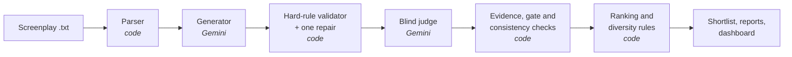

# PromoPilot

**Finds the best promo clips in microdrama screenplays, ranks them, and shows where it gets things wrong.**

Built for the Kuku AI Generalist assignment, Problem 1: *Find the Promos*.

**Live app:** _add the Streamlit link here_ · **Full command reference:** [docs/REFERENCE.md](docs/REFERENCE.md)

---

## The problem

Today an editor watches every episode and picks promo moments by hand, one show at a time, while new shows are
released every week. A good promo is a 20 to 60-second clip from the show that:

- **opens on a hook**: something in the first 3 seconds that stops a scrolling viewer;
- **ends on a cliffhanger**: it cuts at an unresolved moment;
- **makes sense on its own** to someone who has never seen the show.

PromoPilot reads the screenplays (which carry a timestamp for every line and action), proposes promo clips, checks
them, scores them and returns a ranked list an editor can act on.

## What you get

For every promo, PromoPilot gives exactly what the brief asks for:

| Field | Example (promo #1) |
|---|---|
| Episode | Episode 1 |
| Segment | 00:39.00 → 01:18.50 (39.5 s) |
| Hook | 00:39.10 · LADY IN GOLD GOWN: "Because he is marrying me." |
| Cliffhanger | 01:15.00 · LADY IN GOLD GOWN: "Long enough to know he was never going to marry you." |
| Why it works | Witness the ultimate betrayal when a sister steals the bride's groom at the altar. |
| Why this rank | Weighted score 5.00 of 5, ahead of #2 (4.60). |

Hook and cliffhanger lines are quoted verbatim from the screenplay, and every timestamp comes from the screenplay
itself, never from the model. It also reports **where the tool picks badly**, with the concrete reason for each
rejected clip.

## Results on the 50-episode input pack

| | |
|---|---|
| Episodes analysed | 50 |
| Candidate clips proposed | 147 (141 from the generator, 6 repaired versions) |
| Broke a hard rule (bad boundaries) | 9 |
| Failed a quality gate (too weak to post) | 28 |
| Eligible clips | 110 |
| **Promos on the final shortlist** | **25**, durations 20.7 to 57.5 s |
| Episodes with at least one eligible promo | 48 of 50 (EP006 and EP038 have none) |

The shortlist is ordered by a weighted score, then diversified: at most one promo per episode, at most three per
story archetype, and near-duplicates (more than 50% overlap) are removed.

**Robustness check:** re-ranking with equal weights keeps 24 of the 25 shortlisted promos (one swap), with a rank
correlation of 0.97 across all eligible clips. The ranking does not hinge on the exact weights chosen.

## How it works



1. **Parse** (code). Each episode becomes scenes and timed blocks (dialogue, action, camera, sound), each with a
   stable ID such as `EP001_B027`. Format problems are recorded, never silently fixed.
2. **Generate** (AI). Gemini proposes candidate clips, but it can only point at block IDs. It never writes a
   timestamp, so it cannot invent a moment that is not in the script.
3. **Validate** (code). Python enforces the objective rules: 20 to 60 seconds, hook within the first 3 seconds, no
   line of dialogue cut mid-sentence, no ending on a bare transition, and the clip ends within 2 seconds of its
   suspense beat. A failing clip gets one deterministic repair attempt (for example, trimming to the beat), and
   the repaired clip is checked again from scratch.
4. **Judge** (AI). A separate Gemini call scores each clip on six dimensions: hook, narrative tension,
   cliffhanger, context independence, curiosity gap and emotional impact. The judge is **blind**. It sees only the
   clip's own lines, under neutral IDs, and never the generator's reasoning or the rest of the episode. That is
   also how it tests whether the clip makes sense on its own.
5. **Check the judge** (code). Every score must cite blocks inside the clip, and Python verifies each citation.
   Gates require hook, cliffhanger and context scores of at least 3 and an unresolved ending. When a score
   contradicts the judge's own explanation, the clip gets one targeted reassessment. If the contradiction
   persists, the clip is flagged for a human and the verdict is not changed.
6. **Rank** (code). Weighted score: hook 30%, context independence 30%, cliffhanger 25%, emotional impact 15%. Ties
   are broken by cliffhanger, then hook, then context score. Then the diversity rules above are applied.

### Who does what

| AI (Gemini) | Code (Python) | Human |
|---|---|---|
| Proposes candidate clips, as block IDs | Parses screenplays and owns every timestamp | Reviews the shortlist before posting |
| Scores each clip blind, citing evidence | Enforces hard rules; the judge cannot override them | Resolves clips flagged for review |
| Writes the one-line "why it works" | Verifies citations, applies gates, ranks, deduplicates | Decides the final weights and gates |

## How we know it's good, and where it fails

**What is checked automatically**
- Every hard rule is enforced in code, on the final boundaries. Failures are facts, not opinions: 4 clips cut a line
  of dialogue and 5 ended too long after their suspense beat.
- Quality-gate failures carry the judge's own reasons. Of the 28 clips that failed, 19 had a weak cliffhanger
  score, 13 depended too much on context, 8 ended on a resolved moment, and 1 had a weak hook (a clip can fail more
  than one gate).
- The consistency checker requested 33 reassessments. 3 clips are still flagged and shown for human review.
- 413 automated tests cover the parser, validator, repairs, judge checks, ranking and every page of the app.

**Known limitations**
- **One AI judge, not viewers.** Scores are a model's opinion, and the judge is from the same model family as the
  generator. Without human review or audience data, a shortlisted clip can still be a weak promo.
- **No baseline comparison yet.** The pipeline can score a naive "last 30 seconds of each episode" baseline with
  the same judge, but that comparison has not been run on the full pack.
- **Single continuous clips only.** The brief allows promos stitched from several moments; PromoPilot only finds
  one continuous stretch from one episode.
- **"Why it works" is model-written** and has not been reviewed by a person.
- **Screenplay, not video.** It judges what the script says will happen on screen, not the actual footage,
  performance or music.

## Using the app

**Promos to post first** (the default page) shows the ranked promos and a short "where the tool picks badly"
summary. Everything else is in the sidebar:

- **Full candidate analysis**: every clip with its scores, the judge's reasoning, cited evidence highlighted in the
  screenplay, every hard-rule check, repairs and provenance.
- **Where it picks badly**: every rejected or flagged clip, grouped by what went wrong.
- **Scores and ranking rules**: all scores, eligible clips left out by the diversity rules, and the weights, gates
  and sensitivity check.
- **Repairs**: what each automatic repair changed and whether it worked.
- **Downloads**: the raw outputs (`shortlist.csv`, `candidates.csv`, `catalogue.csv`, `report.md`, `ranking.json`).

**Analyse your own screenplays** runs the same pipeline on new input. Upload one or more `.txt` episode files in
the same format as the pack, or a `.zip` of them. Each file is checked as it is uploaded, then the analysis runs
with live progress and shows the results on the same page. It makes real Gemini calls, so it is capped: up to
5 files of 100 KB each per analysis, one analysis at a time, and a daily request limit.

## Run it locally

Requires Python 3.12 and a free [Gemini API key](https://aistudio.google.com/apikey).

```
pip install -r requirements-ui.txt
copy .env.example .env
```

In `.env`, set `GEMINI_API_KEY`, `PROMOPILOT_INPUT_DIR` (the folder of screenplay `.txt` files) and
`PROMOPILOT_OUTPUT_DIR`. Then:

```
python -m promopilot.pipeline parse
python -m promopilot.pipeline generate --run my-run --episodes 1-50
python -m promopilot.pipeline validate --run my-run
python -m promopilot.pipeline judge --run my-run
python -m promopilot.pipeline rank --run my-run
python -m promopilot_ui                 # opens the dashboard at http://localhost:8501
python -m pytest                        # the test suite
```

Every model reply is cached, so re-running a step costs nothing, and an interrupted run resumes where it stopped.
To view the published 50-episode results without running anything, set
`PROMOPILOT_DASHBOARD_DIR=published/fullpack` and start the dashboard.

## Cost and scale

On the 50-episode pack, generation used 54 recorded requests (about 267k prompt and 34k completion tokens). The
judge stage made 181 requests: 147 judgements, 33 reassessments and 1 judgement of a repaired clip. That came to
about 494k prompt and 148k completion tokens, with a median of 3.8 seconds per request. All of it ran on
Gemini's free tier.

Cost grows linearly with the number of episodes, and each show is independent, so shows can be processed in
parallel. The model is a setting, not code: any OpenAI-compatible model can be swapped in through environment
variables (see the [reference](docs/REFERENCE.md#llm-providers)), so a stronger model can replace the free one
without touching the pipeline.

## Repository layout

```
promopilot/            the pipeline: parser, generator, validator, judge, ranking, LLM providers
  prompts/             the generator and judge prompts
promopilot_ui/         the Streamlit app: dashboard pages and the upload page
published/fullpack/    outputs of the 50-episode run that the hosted dashboard reads
tests/                 automated tests (fixtures only, no API calls)
docs/REFERENCE.md      every command, setting and output file
```

## Built with

Python 3.12, Pydantic, Streamlit, and Google Gemini (`gemini-3.5-flash` to generate, `gemini-3.5-flash-lite` to
judge) through its OpenAI-compatible API. Developed with AI assistance in Cursor.
